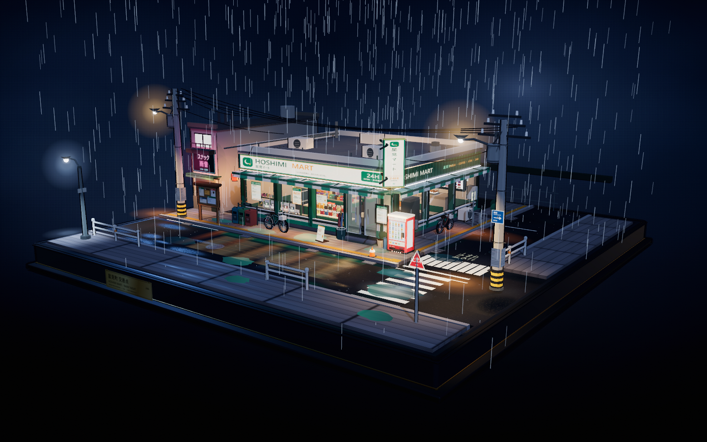

# 星見マート — 雨夜の街角

一个可自由旋转、缩放观看的三渲二雨夜便利店街角微缩场景。全部贴图、招牌、海报、商品与雨景均在浏览器内程序化生成，单文件、无外部依赖、无人物、无 UI 覆盖层。

**在线体验:** https://yancheng0518.github.io/hoshimi-mart-rain-night/

## 操作

- 鼠标左键拖动：旋转视角
- 滚轮 / 双指：缩放
- 双击场景或按 `R`：重播入场组装动画
- 场景无 HUD、按钮或文字说明层

## 内容

- 完整正方形收藏底座、黄铜铭牌
- 日式便利店街角：发光招牌、玻璃橱窗、自动门、雨棚、自动贩卖机、自行车、伞架、分类垃圾桶、路灯、电线杆与电线、路牌、护栏、停车位、排水沟、积水水面、反光斑马线、小巷入口、空调外机、公告栏等
- 透过大玻璃可见暖光店内：货架商品、饮料冷柜、收银台、热食柜、咖啡机、杂志架、ATM、吊牌与海报
- 三渲二材质、描边、暖冷霓虹层次、雨丝 / 水花 / 涟漪、湿地反光
- 入场组装动画：地面 → 建筑墙体 → 店内陈列 → 街景道具 → 灯光招牌 → 雨夜

## 本地打开

直接双击下载的 `index.html`，用 Chrome / Edge 打开即可。
